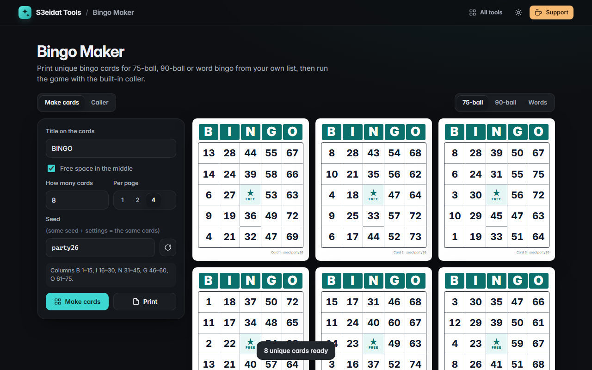

# Bingo Maker

> Printable bingo cards and a bingo caller. Free, private, and it runs entirely in your browser.

### ▶ [Open Bingo Maker](https://s3eidat.github.io/bingo-maker/)



## Features

- **75-ball cards**: B 1–15, I 16–30, N 31–45, G 46–60, O 61–75, with an optional **free space**
- **90-ball tickets**: 3 rows × 9 columns, 5 numbers per row, 1–3 numbers per column, sorted top to bottom
- **Word bingo** from your own list (one per line, 24+ unique words): meetings, baby showers, classrooms, road trips
- **Any number of unique cards** (up to 300), no two the same, shuffled with `crypto.getRandomValues`
- **Seed** for reproducible sets: the same seed and settings always give the same cards, so you can reprint card 17 later
- Print **1, 2 or 4 cards per page** on A4, with cut guides; every card is numbered
- **Caller mode**: big animated ball, last calls, full **history board**, **undo**, progress, keyboard (<kbd>Space</kbd> to call, <kbd>Z</kbd> to undo); the game survives a page refresh

## Privacy

Everything happens on your device. There is no server, no account, no analytics.
The page ships with a strict Content-Security-Policy (`connect-src 'self'`), so the browser
itself blocks any attempt to send data anywhere.

## Run it yourself

It's plain HTML, CSS and JavaScript with no build step:

```bash
git clone https://github.com/s3eidat/bingo-maker
cd bingo-maker
python -m http.server 8000
```

Then open http://localhost:8000.

## Support

If this saved you time, **[buy me a coffee ☕](https://s3eidat.github.io/coffee/)**. It keeps every tool free.

---

Part of **[S3eidat Tools](https://s3eidat.github.io/)**: 100+ free, private tools that run in your browser. MIT licensed.
